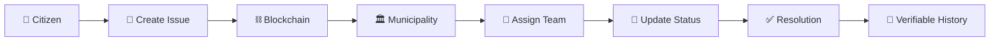
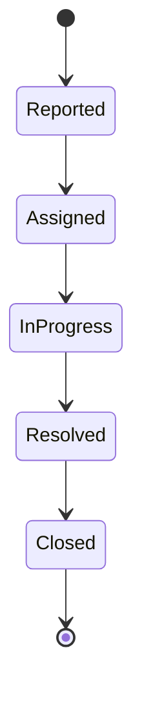
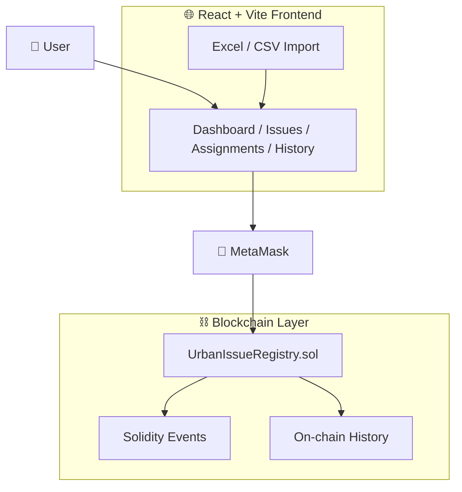
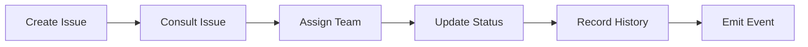
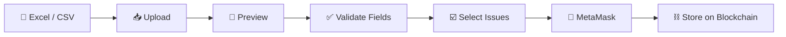
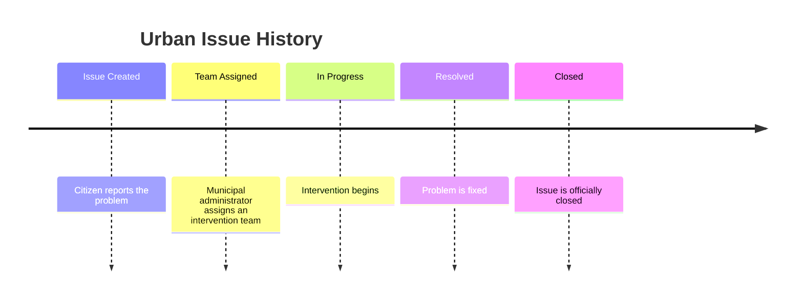
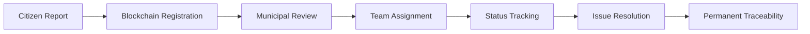

# 🏙️ UrbanIssueRegistry

### Decentralized Urban Issue Management Platform

> A Smart City DApp built with **Blockchain, Solidity, React and MetaMask** to report, track and manage urban issues transparently.

<p align="center">


</p>

---

## 📌 Overview

**UrbanIssueRegistry** is a decentralized application designed for Smart Cities.

The platform allows citizens to report urban problems such as:

- 💡 Street lighting failures
- 🛣️ Road problems
- 🗑️ Waste management issues
- 🚰 Water-related problems
- 🌳 Public-space issues

Municipal administrators can then manage these reports, assign intervention teams, update their status and consult the complete history of actions.

The blockchain provides a **transparent and traceable record** of the important operations performed on each report.

---

## 🎯 Project Objective

The objective is to manage the complete lifecycle of an urban issue:



---

## ✨ Main Features

### 👤 Citizen

- Connect wallet using MetaMask
- Create an urban issue
- Provide issue details and priority
- Receive a unique issue identifier
- Consult registered issues
- View issue status
- Consult issue history

### 🏛️ Municipal Administrator

- Access the municipal management interface
- Assign intervention teams
- Update issue statuses
- Follow the progress of interventions
- Consult the complete history
- Import multiple issues from Excel/CSV

### 🔐 Blockchain

- Unique issue identification
- On-chain issue registration
- Status management
- Team assignment
- Event emission
- Action history
- Blockchain address of the actor
- Access control using the contract owner

---

## 🔄 Issue Lifecycle

Each issue follows a predefined lifecycle:



### Statuses

| Status | Meaning |
|---|---|
| 🟡 `Reported` | Issue reported by a citizen |
| 🔵 `Assigned` | An intervention team has been assigned |
| 🟠 `InProgress` | The intervention is in progress |
| 🟢 `Resolved` | The problem has been resolved |
| ⚫ `Closed` | The issue has been officially closed |

---

# 🏗️ Architecture



---

# 🧩 Project Structure

```text
UrbanIssueRegistry/
│
├── contracts/
│   └── UrbanIssueRegistry.sol
│
├── test/
│   └── UrbanIssueRegistry.ts
│
├── scripts/
│   └── deployment scripts
│
├── frontend/
│   ├── src/
│   │   ├── components/
│   │   │   ├── Header.tsx
│   │   │   └── Sidebar.tsx
│   │   │
│   │   ├── pages/
│   │   │   ├── Dashboard.tsx
│   │   │   ├── CreateIssue.tsx
│   │   │   ├── AllIssues.tsx
│   │   │   ├── Assignments.tsx
│   │   │   ├── StatusManagement.tsx
│   │   │   ├── History.tsx
│   │   │   └── ImportData.tsx
│   │   │
│   │   ├── contracts/
│   │   │   └── UrbanIssueRegistry.json
│   │   │
│   │   ├── contract.ts
│   │   └── config.ts
│   │
│   └── package.json
│
├── hardhat.config.ts
├── package.json
└── README.md
```

---

# 🛠️ Technologies

| Technology | Usage |
|---|---|
| **Solidity** | Smart contract development |
| **Hardhat** | Compilation, deployment and testing |
| **React** | Frontend interface |
| **Vite** | Frontend development environment |
| **TypeScript** | Frontend development |
| **ethers.js** | Blockchain interaction |
| **MetaMask** | Wallet authentication and transactions |
| **SheetJS** | Excel/CSV data import |
| **Hardhat Network** | Local blockchain |

---

# 📦 Smart Contract

The main smart contract is:

```text
UrbanIssueRegistry.sol
```

It manages the complete lifecycle of urban issues.

### Main operations



The contract also uses access control to restrict administrative operations.

Only the **contract owner / municipal administrator** can perform operations such as team assignment and status management.

---

# 👥 User Roles

The application distinguishes between two main roles.

### 👤 Citizen

A normal connected wallet can:

```text
Connect Wallet
      ↓
Create Issue
      ↓
View Issues
      ↓
Track Status
      ↓
View History
```

### 🏛️ Municipal Administrator

The contract owner has additional permissions:

```text
Connect Wallet
      ↓
Administrator
      ↓
Manage Assignments
      ↓
Update Status
      ↓
Track Interventions
```

The role is automatically detected by comparing the connected wallet address with the smart contract owner address.

---

# 📊 Issue Data Model

The application uses the following issue fields:

| Field | Example |
|---|---|
| `issueId` | `CITY-2026-001` |
| `issueType` | `StreetLight` |
| `location` | `Avenue Mohammed V` |
| `description` | `Streetlight not working` |
| `reportDate` | `2026-11-19` |
| `priority` | `High` |
| `reportedBy` | `Citizen01` |
| `assignedTo` | `UrbanTeam01` |
| `status` | `Reported` |

These fields correspond to the data model specified in the project requirements.

---

# 📥 Excel / CSV Import

UrbanIssueRegistry also supports importing multiple urban issues from an **Excel or CSV file**.

### Import workflow



This allows several reports to be prepared and reviewed before being registered on-chain.

---

# 📜 Traceability

One of the main objectives of the project is to maintain a traceable history for each urban issue.



The history can contain information such as:

- Creation date
- Status changes
- Assigned team
- Intervention information
- Blockchain address of the actor
- Important blockchain events

---

# 🔐 Security & Access Control

Administrative operations are protected using ownership-based access control.

```text
                 ┌──────────────────────┐
                 │    MetaMask Wallet   │
                 └──────────┬───────────┘
                            │
                            ▼
                 ┌──────────────────────┐
                 │ Connected Address    │
                 └──────────┬───────────┘
                            │
                   Compare with owner
                            │
             ┌──────────────┴──────────────┐
             │                             │
             ▼                             ▼
       👤 Citizen                    🏛️ Admin
             │                             │
      Public operations          Administrative operations
```

The frontend also hides administrative pages from non-administrator users.

---

# 🧪 Smart Contract Tests

The project includes automated Hardhat tests covering the main contract functionalities.

The current test suite contains **23 passing tests**.

Example:

```bash
npx hardhat test
```

The tests cover functionalities such as:

- Issue creation
- Issue consultation
- Unique identification
- Team assignment
- Status updates
- History
- Events
- Administrative permissions
- Unauthorized access

---

# 🚀 Installation & Setup

## 1. Clone the repository

```bash
git clone https://github.com/nourmiyy03/Smart-City-Blockchain/
cd UrbanIssueRegistry
```

## 2. Install Smart Contract dependencies

```bash
npm install
```

## 3. Compile the Smart Contract

```bash
npx hardhat compile
```

## 4. Start the local blockchain

```bash
npx hardhat node
```

Keep this terminal running.

## 5. Deploy the Smart Contract

Deploy the contract to the local Hardhat network using the project's deployment script.

After deployment, copy the contract address into the frontend configuration.

## 6. Install frontend dependencies

```bash
cd frontend
npm install
```

## 7. Start the frontend

```bash
npm run dev
```

Then open the local Vite URL displayed in the terminal.

---

# 🦊 MetaMask Configuration

The application uses MetaMask to interact with the local blockchain.

For local development:

```text
Network: Hardhat Local
RPC URL: http://127.0.0.1:8545
Chain ID: 31337
Currency: ETH
```

Import one of the accounts provided by the local Hardhat node into MetaMask.

> ⚠️ Never use real funds or real private keys for local development.

---

# 📍 Deployed Contract

Current local deployment:

```text
Network: Hardhat Local
Chain ID: 31337

Contract:
0x8A791620dd6260079BF849Dc5567aDC3F2FdC318
```

> This address is specific to the current local deployment and may change after redeployment.

---

# 🎬 Demo

The demonstration presents the complete lifecycle of an urban issue:

```text
👤 Citizen
   │
   ├── Connect MetaMask
   │
   ├── Create Issue
   │
   ▼
⛓️ Blockchain
   │
   ▼
🏛️ Municipal Administrator
   │
   ├── Assign Team
   │
   ├── Update Status
   │
   ├── Resolve Issue
   │
   ▼
📜 History
   │
   ▼
✅ Closed
```

The video demonstrates:

- Wallet connection
- Citizen issue creation
- Issue consultation
- Administrator access
- Team assignment
- Status management
- History tracking
- Excel/CSV import

---

# 📁 Test Data

The project uses fictitious data for testing, including examples such as:

```text
CITY-2026-001
CITY-2026-002
CITY-2026-003
```

No private or sensitive personal information should be stored on the blockchain.

---

# 🔒 Important Security Notes

- Never store private keys in the frontend.
- Never use real private keys for testing.
- Use only fictitious data.
- Do not store sensitive personal information on-chain.
- Validate imported data before sending blockchain transactions.
- Administrative operations are protected by smart-contract access control.

---

# 🎯 Project Result

UrbanIssueRegistry provides a decentralized workflow for managing urban issues:



The project demonstrates how blockchain technology can be integrated into a **Smart City application** to improve transparency, traceability and management of public-service interventions.

---

## 👨‍💻 Authors

**OUARAGHOUANE Nour El Houda**

> Smart City & Blockchain Mini-Project  
> Master — Data Engineering & Artificial Intelligence

---

<p align="center">

### 🏙️ UrbanIssueRegistry
**Report → Assign → Track → Resolve → Verify**

</p>
